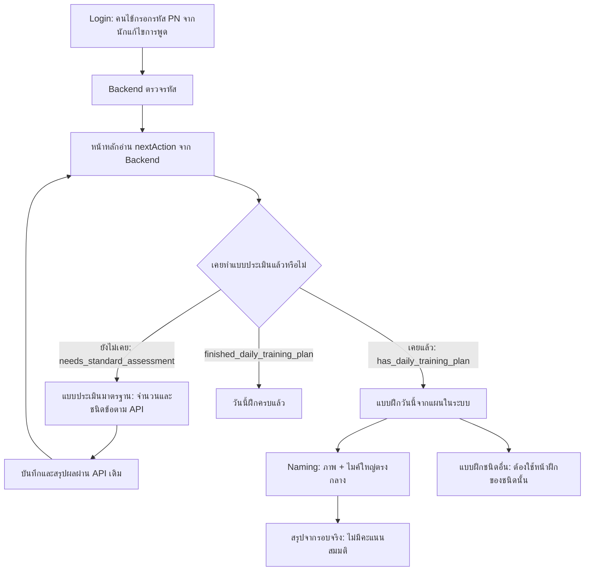

# Patient frontend workflow

> Latest supportive feedback, clickable question circles, revisitable skips and automatic progression: [patient-practice-interactions.md](patient-practice-interactions.md).

> Full 30-question content, distractors, minimal Login and owner-confirmed audio policy: see [standard-assessment-content.md](standard-assessment-content.md). Its details supersede the earlier three-item preview and audio notes below.

## Development preview without a PN account

Open `http://localhost:3000/dev/preview` or use the development-only preview link below the real Login form. Choose new patient, returning patient, the local Naming library, or Naming directly. These isolated routes never create an authenticated session or bypass guards on the real patient routes. The preview layout returns 404 outside `NODE_ENV=development`.

The assessment preview reuses the actual assessment screen with three explicitly labeled Naming UI fixtures, not a real standard assessment. Answers stay local, no audio/answers are submitted to backend endpoints, and no score is invented. Naming preview uses local catalog practice with preview-specific back links. All preview pages carry a persistent mock-data banner.

This document supersedes the UI descriptions in `naming-frontend.md` where they differ. Implementation is frontend-only.

## Patient interface

- Login keeps the two roles. PN validation/authentication still uses the existing frontend/API integration; no passwords are generated on the frontend.
- Home follows the backend's `nextAction.targetPath`. It no longer creates a Naming session for every pending exercise type, and does not request microphone permission before navigation.
- Added the missing `/patient/training/today` page. Naming plans link to the assigned-set entry; other exercise types are explicitly unavailable here until their corresponding frontend is connected. They are never relabeled as Naming.
- Added a frontend training gate on Naming and Today: no session → Login; `needs_standard_assessment` → standard assessment; backend-confirmed assessed states → training. Errors fail visibly instead of bypassing the assessment. This is a frontend navigation guard; backend authorization remains necessary.
- The four categories in the existing code are Naming, Spontaneous, Repetition and Comprehension.
- Difficulty remains internal data. No easy/medium/hard labels are displayed on patient Naming intro, library, practice, summary, home plan labels or assessment results. Patients see categories and set numbers.
- Naming has no typing controls or typed-answer API field. The main action is a 144–176 px circular microphone; after recording, an assigned session uses the same central control to send the audio. Next unlocks after submission, or after reveal. Local additional practice may move on after recording without an API result.
- Naming hints are bottom left, next is bottom right, and Skip is secondary. Short Thai captions accompany pictograms; longer explanations are collapsed under caregiver details.
- Naming images use `object-contain` and responsive sizing. Existing media paths and the 135-word ordering are unchanged. The owner-supplied ผ้าเช็ดตัว completes objects set 3; all nine sets now have complete images.
- Standard assessment voice tasks use a central 160–192 px microphone and real audio only. No text entry or fabricated `mockAnswer` is submitted. Image-choice and yes/no tasks retain their backend-defined interaction types; they are not converted to a different assessment.
- Assessment question count is taken from API questions, not assumed to be 15 or 30. Existing provided non-answer hints may be requested; usage counts are sent via the existing metadata fields. No hint text or sound is invented for the assessment.
- Shared recorder handles permission errors, actual MIME types, late permissions after exit and hardware cleanup. Assessment delayed navigation and milestone audio are cleaned up on exit.
- Correctness feedback is shown only when a real boolean is available from the response; missing results are not treated as a wrong answer.
- No new synthesized speech or navigation audio was introduced.

## Verification and remaining work

- `node --test scripts/naming-frontend.test.mjs`: 11 passing tests. Coverage includes requested lists/media, first/last item, hint/reveal/reset/navigation, audio cleanup, microphone permission/MIME handling, assessed/unassessed/error gate states, hidden difficulty labels and an audio-only request payload.
- Changed frontend files and tests pass ESLint.
- Full `npm run lint`: 12 existing errors and 12 warnings in other files, mostly API `any` annotations.
- `npx tsc --noEmit --incremental false`: only the pre-existing `mockAnswer` type error in therapistClinicalService.ts:255 remains.
- HTTP smoke checks for Today, Naming entry and assessment entry return 200. This does not establish authenticated browser behavior or screen layout.
- Responsive Tailwind layouts are implemented. Desktop/tablet/mobile visual checks, real patient sign-in, actual microphone hardware and authenticated end-to-end backend grading were not tested in a browser in this change. No claim of full device coverage is made.
- Backend must continue to supply assessment status, exercise assignments, authorization and speech-analysis results. The existing skip/persisted-resume/idempotency limitations described in `naming-frontend.md` still apply.
